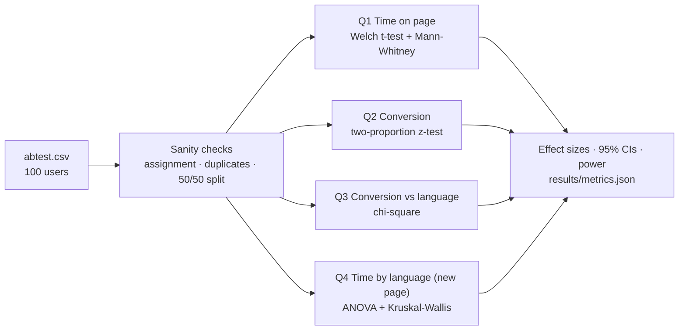
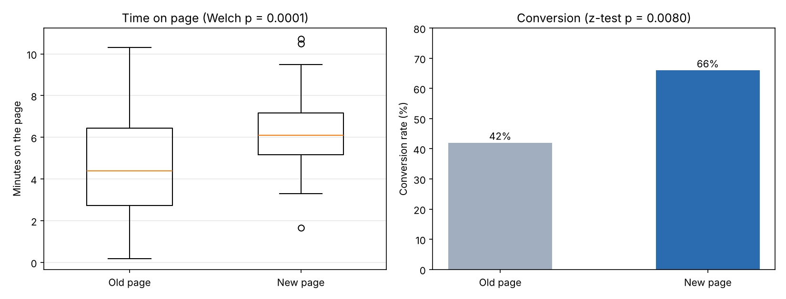

<div align="center">

# A/B Test: New Landing Page against the Current Page

**A statistical evaluation of a redesigned landing page for an online news portal, testing whether it keeps users on the page longer and converts more of them into subscribers.**

[](https://github.com/Collinsthe4th/ab-testing-web-feature/actions/workflows/ci.yml)
[](https://www.python.org/)
[](https://scipy.org/)

</div>

---

## Contents

- [About the project](#about-the-project)
- [Experiment design](#experiment-design)
- [Tech stack](#tech-stack)
- [Results](#results)
- [Interactive dashboard](#interactive-dashboard)
- [Getting started](#getting-started)
- [Project structure](#project-structure)
- [Limitations](#limitations)

## About the project

An online news portal redesigned its landing page and wanted to know if the new version was worth rolling out to every visitor. 100 users were split at random into two groups of 50. The control group saw the old page and the treatment group saw the new page. For each user, the log records the minutes spent on the page, whether they subscribed (converted) and their preferred language (English, French or Spanish).

I answered four questions, each with a formal hypothesis test at a significance level of 5%.

1. Do users spend more time on the new page?
2. Is the conversion rate of the new page higher?
3. Does conversion depend on the preferred language?
4. On the new page, is the time spent the same for every language?

## Experiment design



Before testing anything, I checked that the experiment itself was sound. Every control user saw the old page and every treatment user saw the new page, there were no duplicate users, and the split was exactly 50/50 (sample ratio p-value of 1.0). For each test I also checked its assumptions, for example normality with the Shapiro-Wilk test (a check of whether the data looks bell-shaped) and equal variances with Levene's test. I then repeated the test with a non-parametric version (one that makes no normality assumption) to make sure the conclusion does not depend on those assumptions.

## Tech stack

| Area | Tools |
|---|---|
| Data handling | pandas, NumPy |
| Statistics | SciPy (Welch t-test, z-test, chi-square, ANOVA, Mann-Whitney, Kruskal-Wallis, Shapiro-Wilk, Levene) |
| Visualisation | Matplotlib |
| Testing | pytest (results checked against SciPy and known values), GitHub Actions |

## Results

| Question | Test | Result | p-value | Decision |
|---|---|---|---|---|
| Q1 Time on page | Welch t-test (one-sided) | 6.22 min against 4.53 min | 0.0001 | Reject H0 |
| Q2 Conversion | Two-proportion z-test (one-sided) | 66% against 42% | 0.0080 | Reject H0 |
| Q3 Conversion vs language | Chi-square | no clear link | 0.2130 | Do not reject H0 |
| Q4 New-page time by language | One-way ANOVA | 6.66 / 6.20 / 5.84 min | 0.4320 | Do not reject H0 |

Table 1- Summary of the four hypothesis tests (H0 is the "no difference" hypothesis).



Fig. 1- Time on page and conversion rate for each version of the page. Source: Collins Akagha (2026).

**Q1.** Users of the new page stayed 1.69 minutes longer on average (95% confidence interval 0.80 to 2.58 minutes). The effect size is a Cohen's d of 0.76, which is a medium to large effect. Both groups passed the normality check, and the Mann-Whitney test gave the same conclusion (p = 0.0003).

**Q2.** The conversion rate went from 42% to 66%, a gap of 24 percentage points or a relative lift of 57%. The 95% confidence interval for the gap is wide, from 5.0 to 43.0 points. This means that the new page is very likely better, but the true improvement could be anywhere from small to very large.

**Q3 and Q4.** I found no evidence that conversion depends on language (p = 0.213), or that time on the new page differs by language (p = 0.432, Kruskal-Wallis p = 0.594). This shows that the new page works similarly well for all three language groups, so there is no need for a separate design per language.

**Power.** With 50 users per group, the test had a power of 78.4% to detect a jump from 42% to 66% (that is, a 78.4% chance of spotting a real effect of that size). To reach the usual 80%, the experiment would have needed 53 users per group. The effect was found, but a smaller real effect could easily have been missed with this sample size.

In conclusion, I recommend rolling out the new landing page. It keeps users on the page longer and converts more of them, and it does so equally for English, French and Spanish speakers.

## Interactive dashboard

The Streamlit app (`streamlit_app.py`) shows all four tests and lets you change the significance level and switch between one-sided and two-sided tests. It also has a planner that works out how many users per group the next experiment needs to detect a given lift in conversion.

```bash
streamlit run streamlit_app.py
```

## Getting started

```bash
git clone https://github.com/Collinsthe4th/ab-testing-web-feature.git
cd ab-testing-web-feature
python -m venv .venv && source .venv/bin/activate   # Windows: .venv\Scripts\activate
pip install -r requirements.txt

python scripts/analyse.py    # runs all four tests, writes results/metrics.json and the figure
python -m pytest -q
```

## Project structure

```
ab-testing-web-feature/
├── data/raw/abtest.csv
├── src/abtest/stats.py     # tests, effect sizes, confidence intervals, power
├── scripts/analyse.py      # the full analysis
├── results/                # metrics.json and figures/
└── tests/                  # unit tests checked against SciPy and known values
```

## Limitations

The sample is small (100 users), which is why the confidence interval for the conversion gain is so wide. The data also has no timestamps, so I could not check for a novelty effect (users trying the new page because it is new, and then losing interest). Finally, I ran four tests on the same data without correcting for multiple comparisons. The two significant results have p-values of 0.0001 and 0.0080, so they would still pass a Bonferroni correction (a stricter threshold of 0.05 / 4 = 0.0125).
